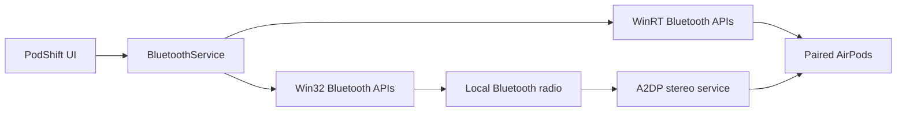

# PodShift

[](https://github.com/agbabenkov-del/PodShift/actions/workflows/build-windows.yml)
[](https://github.com/agbabenkov-del/PodShift/releases)
[](LICENSE)
[](https://dotnet.microsoft.com/)
[](https://www.microsoft.com/windows)

**One-click AirPods switching for Windows.**

PodShift is a small Windows utility that finds your already-paired AirPods, shows their connection state, and switches the stereo A2DP connection between Windows and other devices without forcing you through Bluetooth Settings every time.

> **Latest published release: v0.2-alpha.** One-click connect and disconnect are implemented and have been confirmed on a real AirPods/iPhone/Windows setup. This branch contains **v0.3-alpha**, which turns the window into a compact desktop widget with a tray icon; it has not been released yet. Bluetooth behavior still depends on the Windows Bluetooth stack, adapter, drivers, and AirPods model, so broader hardware testing is welcome.

## Download

Download **`PodShift-win-x64.zip`** from the [releases page](../../releases). The [v0.2-alpha release](../../releases/tag/v0.2-alpha) uses the older window with three separate buttons; the widget and tray behavior described below arrives with v0.3-alpha.

1. Extract the ZIP.
2. Run `PodShift.exe`.
3. If Windows SmartScreen warns about an unknown publisher, that is expected for the current unsigned alpha build.
4. Pair your AirPods with Windows once using normal Bluetooth Settings if you have not done so before.
5. Click **Find AirPods** if PodShift has not found them on its own, then **Connect to PC**.

The build is self-contained. You do **not** need to install .NET separately.

## The problem

AirPods move between Apple devices beautifully. Windows has apparently chosen character building instead.

The normal Windows routine is usually:

1. Open Settings.
2. Open Bluetooth.
3. Find the right device.
4. Connect it.
5. Repeat next time.

PodShift turns that into a tiny window and one click.

## The desktop widget (v0.3-alpha)

PodShift is a small frameless widget, not a settings dialog. It shows the AirPods name, their Windows connection state, and one primary button:

- **Найти AirPods** (Find AirPods) when no AirPods have been found yet. PodShift also searches once automatically at launch.
- **Подключить к ПК** (Connect to PC) when the AirPods are not connected to Windows.
- **Отключить** (Disconnect) when the AirPods are connected to Windows.

While a Bluetooth operation is running the button is disabled, so repeated clicks cannot start a second one.

Widget and tray behavior:

- Drag the widget by its header or background to move it.
- The last position is remembered. If a monitor was removed or the layout changed, the widget is moved back into a visible work area.
- The pin button in the header toggles **Always on top** (**Поверх окон**). The choice is remembered.
- The **X** button hides the widget to the tray; it does **not** quit PodShift.
- Double-click the tray icon, or choose **Показать PodShift** in the tray menu, to bring the widget back.
- The tray menu also has a connect/disconnect action (shown once AirPods are known) and the **Поверх окон** toggle. If you use that action while the widget is hidden, the result appears as a tray notification.
- To fully exit PodShift, right-click the tray icon and choose **Выход**.

Settings (position and always-on-top) are stored in `%LOCALAPPDATA%\PodShift\settings.json`. If the file is missing or damaged, PodShift starts with defaults.

## What it does

- Finds AirPods among already-paired Bluetooth devices.
- Prioritizes AirPods Pro, AirPods Max, and AirPods by name.
- Shows the current Windows connection state.
- Performs one-click A2DP connect by resetting and re-enabling the stereo service.
- Performs one-click disconnect by disabling the A2DP stereo service.
- Uses the actual local Bluetooth radio handle for native Windows Bluetooth calls.
- Waits for Windows to confirm the resulting connection state instead of assuming success.
- Refreshes status when the app becomes active again.
- Falls back to Windows Bluetooth Settings when the native operation cannot be completed.
- Handles long AirPods names and Windows display scaling without clipping the lower controls.

## How it works

Windows does not expose a simple public call such as `ConnectBluetoothAudioDevice(deviceId)` for an already-paired audio device.

PodShift uses two layers:

- **WinRT Bluetooth APIs** for discovery, Bluetooth address lookup, and `ConnectionStatus`.
- **Win32 Bluetooth APIs** from `bthprops.cpl` to locate the correct Bluetooth radio and toggle the A2DP service with `BluetoothSetServiceState`.



### Connect sequence

1. Read the AirPods Bluetooth address.
2. Find the local Bluetooth radio that knows the device.
3. Disable the A2DP service.
4. Wait one second.
5. Enable A2DP again.
6. Wait up to 10 seconds for Windows to report the AirPods as connected.

### Disconnect sequence

1. Find the same Bluetooth device and radio.
2. Disable A2DP.
3. Wait for Windows to report the AirPods as disconnected.

The current implementation is intentionally **A2DP-first**. Hands-Free/headset mode is not toggled because the first goal is reliable stereo audio switching.

## Requirements

- Windows 10 or Windows 11
- x64 PC
- Working Bluetooth adapter/radio
- AirPods already paired with Windows at least once

PodShift does **not** perform initial Bluetooth pairing.

## Known limitations

- Reliability can vary with Bluetooth adapters, drivers, Windows builds, and AirPods models.
- Another device may temporarily hold the AirPods connection and delay or prevent Windows from taking it.
- The app currently selects the highest-scoring AirPods device automatically. There is no device picker yet.
- Microphone / Hands-Free mode is not managed yet.
- The executable is not code-signed yet.
- There is no installer yet.
- The widget and tray behavior has not been verified on real hardware across multiple monitors and DPI settings yet.

If one-click switching fails, PodShift opens the normal Windows Bluetooth Settings as a fallback rather than pretending everything went splendidly.

## Build from source

```powershell
git clone https://github.com/agbabenkov-del/PodShift.git
cd PodShift
dotnet restore PodShift.csproj
dotnet build PodShift.csproj -c Release
```

To create the same self-contained build used by GitHub Actions:

```powershell
dotnet publish PodShift.csproj `
  -c Release `
  -r win-x64 `
  --self-contained true `
  -p:PublishSingleFile=true `
  -p:IncludeNativeLibrariesForSelfExtract=true `
  -o publish
```

## Tech

- C#
- .NET 8
- WPF / XAML (Windows Forms `NotifyIcon` for the tray icon)
- Windows.Devices.Bluetooth / WinRT
- Win32 Bluetooth APIs via P/Invoke
- GitHub Actions

The Bluetooth switching logic lives in [`BluetoothService.cs`](BluetoothService.cs).

## Roadmap

- [x] Find paired AirPods
- [x] Show connection state
- [x] One-click A2DP connect
- [x] One-click A2DP disconnect
- [x] Automatic status refresh
- [x] Responsive window sizing
- [x] Self-contained Windows build
- [x] Automated prerelease packaging
- [ ] Test on more AirPods models, Windows versions, and Bluetooth adapters
- [ ] Device picker for multiple AirPods
- [x] Compact desktop widget with remembered position and optional always-on-top
- [x] Tray icon with close-to-tray and quick connect/disconnect
- [ ] Optional Retro 95 skin
- [ ] Installer and code signing
- [ ] Demo GIF / polished screenshots

## Testing and feedback

Real-world Bluetooth reports are extremely useful. When reporting a problem, please include:

- AirPods model
- Windows version
- Bluetooth adapter or laptop model, if known
- Whether **Connect** worked
- Whether **Disconnect** worked
- The exact message PodShift displayed if it failed

Use the repository's [issue templates](../../issues/new/choose) for bugs and feature requests.

## Contributing

Pull requests are welcome. See [CONTRIBUTING.md](CONTRIBUTING.md) before making larger changes.

## License

PodShift is available under the [MIT License](LICENSE).

## Trademark notice

AirPods is a trademark of Apple Inc. PodShift is an independent project and is not affiliated with, endorsed by, or sponsored by Apple or Microsoft.
